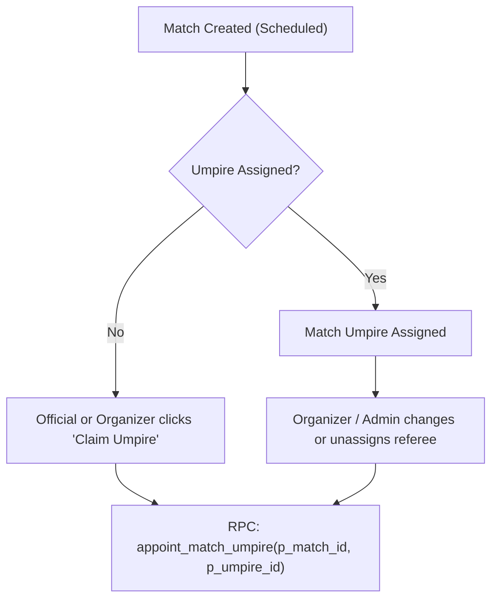

# Referee Mode & Live Scoring UX

ScoreBoard Mobile empowers umpires, club referees, and casual players to score matches directly from their smartphones on court.

---

## 1. Referee Assignment Lifecycle

### Referee Privileges:
- Only the **designated umpire** (`umpire_id = auth.uid()`) or the **tournament organizer** (`organizer_id = auth.uid()`) has permission to dispatch score updates to Supabase.
- If unassigned, any verified referee can self-assign via `appoint_match_umpire`.

---

## 2. Touch Scorekeeping Controls

The scoring interface (`src/app/match/score/[id].tsx`) is optimized for single-hand court use:
- **Big Touch Targets**: Point buttons take up 50% of the screen height per team/player.
- **Undo / Redo Buffer**: Allows rolling back erroneous clicks (e.g. accidentally awarded point).
- **Service & Side Tracking**: Visual indicators indicate which player is serving and automatically prompt for court change (*Troca de Campo*) during odd games or tiebreak intervals.
- **Sport-Specific Modal Controls**:
  - *Golden Point (Punto de Oro)*: Modal prompt to pick receiving side at 40-40 in Padel.
  - *Tiebreak Switch*: Automatically transitions score display from games to tiebreak points.
