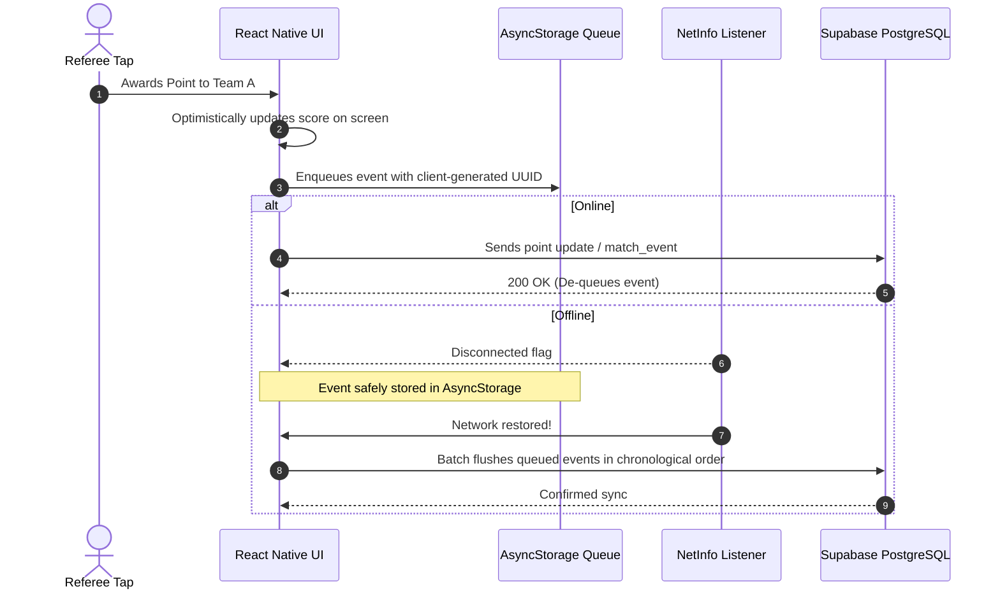

# Offline Queue & Realtime Synchronization

Mobile connectivity at sports clubs and outdoor courts can be unstable. ScoreBoard implements an **offline-first optimistic queue** to guarantee zero lost points.

---

## 1. Offline Scoring Flow

---

## 2. Realtime WebSocket Feeds

For spectators viewing matches on the mobile app:
- Subscribes via `@supabase/supabase-js` to channel `match-{matchId}`.
- Listens to `postgres_changes` on `matches` where `id = matchId`.
- Updates React state without pulling entire lists, preserving mobile battery life and cellular data.
