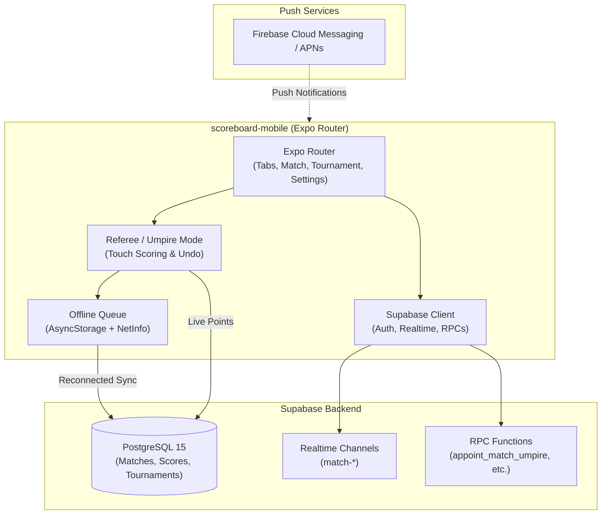

# ScoreBoard Mobile — Technical Wiki & App Architecture

Welcome to the technical knowledge base for **`scoreboard-mobile`**, the cross-platform mobile application for ScoreBoard built with **React Native**, **Expo Router**, NativeWind, and Supabase.



---

## 📚 Mobile Wiki Index

| Document | Topic | Description |
| :--- | :--- | :--- |
| **[`01-architecture-mobile.md`](file:///Users/goncaloforte/Sandbox/ScoreBoard/scoreboard-mobile/docs/01-architecture-mobile.md)** | **Expo Router & UI** | File-based routing (`src/app/`), tab navigation, NativeWind styling, and screen hierarchy. |
| **[`02-referee-mode.md`](file:///Users/goncaloforte/Sandbox/ScoreBoard/scoreboard-mobile/docs/02-referee-mode.md)** | **Referee Mode & Live Scoring** | Match umpire claim (`appoint_match_umpire`), referee unassignment, touch gestures, undo/redo mechanics. |
| **[`03-offline-sync-and-realtime.md`](file:///Users/goncaloforte/Sandbox/ScoreBoard/scoreboard-mobile/docs/03-offline-sync-and-realtime.md)** | **Offline Queue & Realtime** | Optimistic UI updates, `AsyncStorage` queue, NetInfo reconnection sync, Supabase Realtime feeds. |
| **[`04-backend-integration.md`](file:///Users/goncaloforte/Sandbox/ScoreBoard/scoreboard-mobile/docs/04-backend-integration.md)** | **Supabase & Push Services** | React Native Supabase auth session, `expo-notifications`, token registration, and Pro status checks. |

---

## 🛠️ Repository Layout

```text
scoreboard-mobile/
├── src/
│   ├── app/                     # Expo Router navigation routes
│   │   ├── (tabs)/              # Feed, Explore, Favorites, Profile
│   │   ├── match/               # Match details and live referee scoring
│   │   ├── tournament/          # Tournament brackets and standings
│   │   └── settings.tsx         # Unified settings and profile
│   ├── components/              # Shared mobile components
│   ├── hooks/                   # Custom hooks (auth, realtime, offline)
│   ├── lib/                     # Supabase client, scoring rules, offline queue
│   └── global.css               # NativeWind styling root
├── docs/                        # Mobile technical wiki
└── .agents/                     # AI Agent configuration
    ├── rules/docs-sync.md       # Mobile documentation synchronization rule
    └── skills/living-docs/      # Living Docs skill
```
