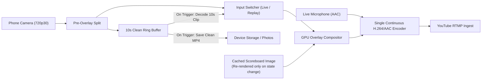

# Mobile Live Video Streaming & Instant Replay (`scoreboard-mobile`)

* **Author:** gjoforte
* **Date:** 2026-11-27
* **Status:** Draft
* **Predecessor Brief:** [concepts_brief.md](file:///Users/goncaloforte/Sandbox/ScoreBoard/scoreboard-mobile/concepts_brief.md)

## The Problem

Amateur clubs, parents, and tournament organizers want to broadcast matches live to YouTube with a live ScoreBoard overlay, using only a phone at the court or field. Today, ScoreBoard's broadcast overlay (`/match/[matchId]/overlay` in `scoreboard-web`) requires a laptop running desktop streaming software such as OBS Studio or vMix, a capture setup, and manual scene configuration. That setup is too heavy for casual or courtside matches.

Existing mobile sports-streaming apps such as Ultimate Streamer solve parts of this problem, but they are iOS-only and assume a single person holds or stands beside the filming phone to tap score updates. In real amateur matches, clubs have mixed iOS and Android devices, and the filming phone is often mounted on a tripod or fence while a separate referee or scorekeeper updates the score from another phone.

## Overview

This design adds live video streaming and 10-second instant replay directly to `scoreboard-mobile` (iOS and Android) as a conservative v1 proof-of-concept. A user can stream a match at `720p30` directly from their phone to their own YouTube channel using an RTMP URL and Stream Key, with a live scoreboard overlay drawn directly onto the video feed.

Both single-device and two-device workflows are supported:
- **Two-device workflow:** One phone is mounted to film and publish the stream while a second device (phone or web) updates the score over ScoreBoard's existing real-time match sync.
- **Single-device workflow:** One phone films, publishes the stream, and exposes minimal edge-docked scoring controls with a camera-touch lock so tapping the score does not shift focus or exposure.

During the broadcast, the app keeps a rolling 10-second buffer of clean camera footage. When the operator triggers a replay, the app saves that 10-second clip locally on the phone and momentarily replaces the live camera feed in the YouTube stream with the replay clip—while keeping live microphone audio running and displaying the live scoreboard plus a "Replay" badge—without dropping the broadcast connection.

## Goals

* **Cross-platform mobile streaming:** Run on both iOS and Android inside `scoreboard-mobile` (via custom native builds) with a conservative `720p30` target tuned for full-match thermal and cellular network stability.
* **Direct user-owned YouTube streaming:** Allow users to stream directly to their own YouTube channel by entering their RTMP URL and Stream Key (stored securely on-device for reuse), with zero server-side video transcoding or cloud compositing costs.
* **Flexible scoring workflows:** Support both single-device (film + score on one phone) and two-device (dedicated filming phone synced to a separate scorer via `match:{id}` Realtime) operation.
* **Live scoreboard overlay:** Composite a native scoreboard overlay directly onto the outgoing video stream, updating automatically as match state changes.
* **10-second instant replay without stream drops:** Maintain a rolling 10-second pre-overlay buffer that exports a clean MP4 clip locally and injects the replay into the live broadcast (with live audio, live score, and a "Replay" badge) without interrupting the RTMP connection.

## Non-Goals

* **Mobile browser streaming:** Streaming from `scoreboard-web` in iOS Safari or Android Chrome is out of scope.
* **Platform-hosted streaming or shared YouTube channel:** ScoreBoard will not host live video feeds on its own servers or route user broadcasts into a single shared ScoreBoard YouTube channel.
* **Google OAuth / YouTube Broadcast API in v1:** Automatic broadcast creation via Google sign-in is deferred to v2; v1 uses manual RTMP URL + Stream Key entry.
* **Advanced broadcast production features:** Multi-camera switching, slow-motion speed ramps, multi-clip highlight stitching, custom sponsor ad carousels, and `1080p`/`4K` streaming are deferred past v1.

## Technical Plan

### 1. High-Level Architecture & JS/Native Split

Live video capture, GPU compositing, 10-second ring buffering, hardware encoding, and RTMP publishing cannot run reliably in JavaScript or Expo Go. Instead, `scoreboard-mobile` splits responsibilities across two layers:

* **TypeScript / React Native Layer (`scoreboard-mobile/src/`):**
  * Subscribes to match state via Supabase Realtime (`score_update`, `SCORE_UPDATED`, and `postgres_changes` on `matches`), matching the pattern already used in `src/app/match/[id]/scoreboard.tsx`.
  * Reads and saves the user's RTMP URL and Stream Key in `expo-secure-store`.
  * Monitors network connectivity (`@react-native-community/netinfo`) and keeps the screen awake (`expo-keep-awake`) in landscape mode (`expo-screen-orientation`).
  * Renders the operator UI (camera preview, stream health pill, replay button, and optional single-device minimal score strip with camera-touch lock).
  * Sends a compact `OverlaySnapshot` JSON object across the native bridge **only when match state or replay badge state changes**.
* **Native Module Layer (`scoreboard-mobile/modules/live-streamer/`):**
  * Implemented as an Expo Module wrapping **HaishinKit** (iOS, Swift/Metal) and **RootEncoder** (Android, Kotlin/OpenGL ES/CameraX) behind one TypeScript API.
  * Owns camera/microphone capture, the 10-second pre-overlay circular buffer, local MP4 export, cached overlay image rendering, GPU compositing, hardware H.264/AAC encoding (`720p30`), and RTMP publishing.

### 2. Stream Continuity & 10-Second Instant Replay Pipeline

YouTube RTMP ingest requires monotonic video/audio timestamps, fixed 2-second keyframe intervals (GOP), and an uninterrupted audio clock. Stopping the camera or swapping encoders during a replay breaks the clock and drops the broadcast.

To prevent drops, the native module runs **one permanent hardware H.264/AAC encoder and RTMP connection** for the entire match:
1. **Pre-Overlay Ring Buffer:** Raw camera frames (before the scoreboard is drawn) are continuously written to a rolling 10-second circular buffer (either compressed clean GOP segments in memory or rotating 2-second temp MP4 chunks).
2. **Replay Trigger:** When the operator taps **Replay (10s)**:
   * The buffer freezes/copies the last 10 seconds and writes a clean MP4 clip (no scoreboard baked in) to local device storage/camera roll.
   * Simultaneously, the native player decodes that 10-second clip and feeds its frames into the GPU compositor's input slot instead of the live camera texture.
   * Live microphone audio continues flowing into the encoder uninterrupted.
   * The cached scoreboard overlay adds a visible `REPLAY` badge while continuing to reflect live score updates.
   * After 10 seconds (or if the operator cancels early), the input switcher cuts back to the live camera texture.

### 3. On-Change Cached Overlay Rendering

Redrawing a UI layout 30 times per second on CPU/GPU accelerates thermal throttling during 60–120 minute matches.
* Whenever JS sends a new `OverlaySnapshot` (team names, current score/sets, status, optional `isReplay` flag), the native side draws the scoreboard HUD **once** into an offscreen bitmap/GPU texture.
* For every video frame at 30fps, the GPU compositor simply alpha-blends that static cached texture onto the video frame at near-zero CPU cost.
* If a sport displays a running match clock, JS or native ticks the clock at 1Hz (once per second) rather than per frame.

### 4. Single-Device vs. Two-Device Workflows

* **Entry Point (`src/app/match/[id]/stream.tsx`):** Accessible from the match detail screen (`src/app/match/[id].tsx`).
* **Two-Device Mode:** Any user with match access can open the stream screen as the camera operator. The scoreboard overlay updates passively from Supabase Realtime as the referee/umpire scores on a second device.
* **Single-Device Mode:** If the operator also has edit permission (`isOrganizer || isUmpire`, matching `scoreboard.tsx`), a toggleable edge-docked score strip (`+1` / `-1` per side) sits along the side bezel in landscape, paired with a **Camera Touch Lock** toggle that disables tap-to-focus/exposure gestures so scoring taps do not disturb the image.

### 5. Native Module Contract & Resilience

Exposed TypeScript interface in `scoreboard-mobile/modules/live-streamer`:
* `startStream(config: { rtmpUrl: string; streamKey: string; width: 1280; height: 720; fps: 30; bitrateKbps: number }): Promise<void>`
* `stopStream(): Promise<void>`
* `updateOverlay(snapshot: OverlaySnapshot): void`
* `triggerReplay(): Promise<{ localUri: string }>`
* `cancelReplay(): Promise<void>`
* `onStreamEvent(listener: (event: StreamHealthEvent) => void): Subscription` (reports bitrate, actual fps, thermal state, RTMP connection state, and replay countdown).

**Thermal & Network Safeguards:**
* **Adaptive Bitrate (ABR) & Reconnect:** Monitor RTMP send queue depth; step down video bitrate (e.g., `2500 → 1200 kbps`) on cellular congestion and auto-reconnect with exponential backoff on transient socket drops.
* **Thermal Monitoring:** Read `ProcessInfo.thermalState` (iOS) and `PowerManager.getThermalHeadroom` (Android). Surface a warning pill on-screen and allow shedding load (pausing the 10-second replay buffer) before the OS throttles or kills the camera session.
* **Early PoC Gate:** Before building full UI polish, validate the `Live ↔ Replay` input texture switch on physical iOS (HaishinKit) and Android (RootEncoder) devices over a 30+ minute YouTube RTMP test stream.

## Alternatives Considered

* **Browser-based streaming in `scoreboard-web#47`:** Rejected by author. Mobile browsers (iOS Safari and Android Chrome) lack reliable background execution, low-level hardware RTMP encoding, and deterministic 10-second rolling video buffers. Migrating the feature to `scoreboard-mobile` unlocks native camera, GPU, and hardware encoder APIs.
* **Single platform-owned shared YouTube channel:** Rejected by author. Routing all user broadcasts into one ScoreBoard-owned YouTube channel creates a single point of failure: one match's background venue music can trigger a Content ID or DMCA strike that suspends live streaming for all users, hits shared YouTube Data API quota limits, and mixes unrelated public/private VODs on one channel.
* **On-device WebView compositing of `/match/[matchId]/overlay`:** Rejected by author. Running a live offscreen browser view alongside camera capture and hardware encoding adds heavy CPU, GPU, and battery overhead, increasing the risk of thermal throttling or OS app termination during full-length matches on iOS and Android.
* **Server-side cloud video compositing:** Rejected by author. Sending raw camera video to a cloud media server to render `/match/[matchId]/overlay` and re-encode for YouTube introduces ongoing per-minute transcoding and bandwidth costs plus 2–5 seconds of extra latency, which conflicts with a conservative, zero-server-video-cost v1 proof-of-concept.
* **Google OAuth / YouTube Broadcast API in v1:** Rejected by author for v1. Using YouTube Data API OAuth (`youtube.force-ssl`) requires passing Google's app verification review and managing OAuth token refresh lifecycles before public release. Using a pasted RTMP URL and Stream Key lets v1 ship faster and also works with non-YouTube RTMP destinations, while leaving Google OAuth open for v2.

## Detailed Implementation

1. **Native Permissions & Build Configuration**
   * `scoreboard-mobile/app.json` (Modify): Add iOS `NSCameraUsageDescription`, `NSMicrophoneUsageDescription`, and `NSPhotoLibraryAddUsageDescription`, plus Android `CAMERA`, `RECORD_AUDIO`, and media write permissions so the OS permits camera/mic capture and saving clean 10-second replay MP4s locally.
   * `scoreboard-mobile/package.json` (Modify): Register the local `modules/live-streamer` Expo module dependency and `expo-media-library` (for exporting saved 10-second replay clips to the device's gallery/photos).
   * `scoreboard-mobile/ios/Podfile` & `scoreboard-mobile/android/build.gradle` (Modify via Expo prebuild/autolinking): Link **HaishinKit** on iOS and **RootEncoder** on Android inside the native module podspec/Gradle build.

2. **Native Streaming & Replay Expo Module (`scoreboard-mobile/modules/live-streamer/`)**
   * `scoreboard-mobile/modules/live-streamer/expo-module.config.json` (Create): Declare the `LiveStreamer` native module for iOS and Android Expo autolinking.
   * `scoreboard-mobile/modules/live-streamer/src/types.ts` (Create): Define the TypeScript schemas for `StreamConfig`, `OverlaySnapshot`, `ReplayResult`, and `StreamHealthEvent` (bitrate, fps, thermal level, RTMP status, replay countdown).
   * `scoreboard-mobile/modules/live-streamer/src/index.ts` (Create): Expose the unified JS/TS bridge (`startStream`, `stopStream`, `updateOverlay`, `triggerReplay`, `cancelReplay`, `onStreamEvent`) and the native `LiveStreamerPreview` view component.
   * `scoreboard-mobile/modules/live-streamer/ios/LiveStreamerModule.swift` (Create): Expo Module entry point bridging JS calls and events to the iOS streaming pipeline.
   * `scoreboard-mobile/modules/live-streamer/ios/VideoPipeline.swift` (Create): Manage the single continuous HaishinKit `RTMPStream` (`720p30` H.264/AAC), adaptive bitrate throttling, `ProcessInfo.thermalState` monitoring, and upstream Metal texture switching (`CameraTexture` ↔ `ReplayPlayerTexture`) without dropping the RTMP session.
   * `scoreboard-mobile/modules/live-streamer/ios/OverlayRenderer.swift` (Create): Render `OverlaySnapshot` into a cached offscreen bitmap/Metal texture only when match state or `isReplay` changes, and alpha-blend it onto outgoing frames.
   * `scoreboard-mobile/modules/live-streamer/ios/ReplayRingBuffer.swift` (Create): Maintain a rolling 10-second pre-overlay circular buffer of clean camera frames/GOPs and export a clean MP4 file on trigger.
   * `scoreboard-mobile/modules/live-streamer/android/src/main/java/dev/goncaloforte/livestreamer/LiveStreamerModule.kt` (Create): Expo Module entry point bridging JS calls and events to the Android streaming pipeline.
   * `scoreboard-mobile/modules/live-streamer/android/src/main/java/dev/goncaloforte/livestreamer/VideoPipeline.kt` (Create): Manage the single continuous RootEncoder RTMP session (`720p30` H.264/AAC), adaptive bitrate throttling, `PowerManager.getThermalHeadroom` monitoring, and OpenGL ES input surface switching (`CameraSurface` ↔ `ReplayPlayerSurface`).
   * `scoreboard-mobile/modules/live-streamer/android/src/main/java/dev/goncaloforte/livestreamer/OverlayRenderer.kt` (Create): Render `OverlaySnapshot` into a cached Canvas/GL texture only on state change and composite it over outgoing frames.
   * `scoreboard-mobile/modules/live-streamer/android/src/main/java/dev/goncaloforte/livestreamer/ReplayRingBuffer.kt` (Create): Maintain the rolling 10-second pre-overlay clean buffer and write a clean local MP4 file on trigger.

3. **TypeScript State, Storage & Operator UI (`scoreboard-mobile/src/`)**
   * `scoreboard-mobile/src/lib/streaming/rtmpCredentials.ts` (Create): Store, retrieve, and clear the user's RTMP URL and Stream Key in `expo-secure-store` so credentials persist across matches without leaving plain text in AsyncStorage.
   * `scoreboard-mobile/src/lib/streaming/overlaySnapshot.ts` (Create): Pure mapper converting match metadata, scores, sport format, and `isReplay` flag into a compact `OverlaySnapshot` with equality checks so JS only bridges actual changes.
   * `scoreboard-mobile/src/hooks/useMatchRealtime.ts` (Create): Extract the Supabase Realtime subscription (`score_update`, `SCORE_UPDATED`, `postgres_changes`) from `src/app/match/[id]/scoreboard.tsx` into a shared hook used by both `scoreboard.tsx` and the new stream screen.
   * `scoreboard-mobile/src/app/match/[id]/scoreboard.tsx` (Modify): Adopt `useMatchRealtime.ts` to avoid duplicating Realtime subscription logic.
   * `scoreboard-mobile/src/components/streaming/RtmpSetupModal.tsx` (Create): Modal for pasting and validating the YouTube RTMP URL + Stream Key before going live.
   * `scoreboard-mobile/src/components/streaming/StreamControlsOverlay.tsx` (Create): Operator HUD showing stream status, bitrate/thermal pill, `Replay (10s)` trigger with countdown (`REPLAYING 0:07 → LIVE`), and—when authorized—an edge-docked `+1`/`-1` score strip with a Camera Touch Lock toggle.
   * `scoreboard-mobile/src/app/match/[id]/stream.tsx` (Create): Landscape streaming route (`expo-screen-orientation`, `expo-keep-awake`, `@react-native-community/netinfo`) wiring `LiveStreamerPreview`, `useMatchRealtime`, `overlaySnapshot`, and `StreamControlsOverlay`.
   * `scoreboard-mobile/src/app/match/[id].tsx` (Modify): Add a "Live Stream" action button on the match detail screen linking to `/match/[id]/stream`.
   * `scoreboard-mobile/src/lib/i18n/types.ts`, `scoreboard-mobile/src/lib/i18n/locales/en.ts`, & `scoreboard-mobile/src/lib/i18n/locales/pt.ts` (Modify): Add localized strings for RTMP setup, replay controls, touch lock, and thermal/network warnings.

4. **Testing & Documentation**
   * `scoreboard-mobile/tests/match/overlaySnapshot.test.ts` (Create): Unit tests verifying `OverlaySnapshot` mapping across sports and confirming duplicate states do not emit redundant native updates.
   * `scoreboard-mobile/tests/match/streamScreen.test.tsx` (Create): Component tests (with mocked `LiveStreamer` native module) verifying RTMP credential persistence, Replay trigger/countdown state, two-device read-only controls vs. single-device score strip, and Camera Touch Lock behavior.
   * `scoreboard-mobile/docs/05-live-streaming.md` (Create) & `scoreboard-mobile/docs/README.md` (Modify): Document the native streaming architecture, PoC verification checklist (30+ minute iOS/Android physical device RTMP + replay switch test), and add it to the mobile wiki index.

